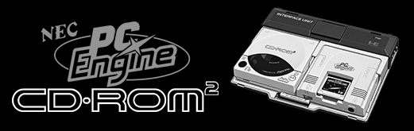

# PC Engine CD for Analogue Pocket

A PC Engine CD / TurboGrafx-CD core with save states and more

This core was originally forked from [Mazamars312's openfpga-pcengine-cd](https://github.com/Mazamars312/openfpga-pcengine-cd), which in turn is built on top of [agg23's PC Engine / TurboGrafx-16 core](https://github.com/agg23/openfpga-pcengine). This version uses the latest MiSTer chips, fixes a whole load of bugs, and adds in some new features. Here's what you can expect:

- **High compatibility.** CUEs with PREGAP lines, CUEs over 16K and CUEs that point into another folder all now load. Fan translations, including the English patched version of Castlevania: Rondo of Blood, can be played on this core.
- **2K saves.** The PC Engine CD's built-in save system works reliably for saving and loading games. The Memory Base 128 is also supported.
- **Memories and Sleep.** Pause and resume anywhere with save states and sleep/resume.
- **HuCards.** Play regular PC Engine / TurboGrafx-16 games too, with Memories and Sleep.
- **Analogizer.** Play on a CRT or TV.
- **Some more stuff** including support for multi-disc games, CD+G, and the option to skip the system card title.

## Installation

You will need an Analogue Pocket on firmware 2.3 or later. No game data or system card comes with this core: you'll need your own PC Engine CD / TurboGrafx-CD discs and a system card.

1. Download the zip from the latest release on GitHub and merge `Cores`, `Platforms` and `Assets` into the folders already on your Analogue Pocket's SD card.
2. Copy your system card into `Assets/pcecd/common/`: `bios_3_0_jap.pce` by default, with `bios_3_0_usa.pce`, `bios_2_0_usa.pce`, `bios_2_0_jap.pce` or `bios_1_0_jap.pce` as other choices.
3. Copy your discs into the same folder as `.cue` and `.bin` files.
4. On the Pocket: openFPGA → PC Engine CD, then pick a disc's `.cue` (or a HuCard's `.pce`, see below).

Saves are stored in `Saves/pcecd`.

A CD+G disc needs its subcode beside its CUE, in a `.sub` of the CUE's name (the CloneCD form, the same as the MiSTer core reads), or a `TRACK nn CDG` in the CUE (2448 bytes a sector). Its pictures are on the GRAPHICS screen of the system card's CD player, on system card 2.0 or later.

## HuCards

The core plays HuCards as well as discs. Copy them as `.pce` files into `Assets/pcecd/common/`, and pick one from the same list as the discs. The system card still needs to be in place, although a HuCard boots straight into its game with no CD unit attached. Memories and Sleep work for HuCards as they do for discs.

The system cards are `.pce` files too, so they show up in the list. Picking one just shows its title screen.

## Memories and Sleep

This core supports Memories (save states) and Sleep. A Memory is 448K, 576K with the Memory Base 128 on, and up to 2.6 MB once a game has used the Arcade Card's RAM. A memory made with another system card, or with the Arcade Card in it when Arcade System has been turned off, won't load.

## Memory Base 128

The Memory Base 128 is the add-on for save backups. Turn on Memory Base 128 in Core Settings and a game that looks for one finds one. It's off by default, as it is on MiSTer. With it on, the game's `.sav` becomes 130K: the same 2K first, then the 128K, so an old 2K save loads as it was. Turning the setting off again doesn't cut a 130K save down.

## Analogizer

The core supports RndMnkIII's [Analogizer](https://github.com/RndMnkIII/Analogizer),
which plugs into the Pocket's cartridge slot. It sends the console's own
picture to a CRT or TV, and lets you play with SNAC controllers.

- **Video**: the console's 15 kHz picture as RGBS, RGsB, YPbPr or Y/C (NTSC or PAL), or 31 kHz for a VGA monitor through the scandoubler, with 0–75 % scanlines (HQ2x shows as the plain scandoubler).
- **Controllers**: PC Engine 2- and 6-button pads and the PC Engine multitap, and DB15, NES and SNES pads, through a SNAC adapter, for any of the four players. They work as the Pocket's own controls do, so players 2 to 4 need Use Turbo Tap on and buttons III to VI need Use 6 Button Ctrl.
- **Setup**: the core reads the shared `analogizer.bin` in `Assets/analogizer/common/`, which Pupdate or AnalogizerConfigurator writes. That file sets the video mode, the controllers and whether the Pocket's own screen stays on. Without it the core works as normal.

Once an Analogizer is set up in `analogizer.bin`, the core drives the cartridge
slot, as every Analogizer core does, so play with the adapter in the slot rather
than a game cartridge. Without it set up, the core leaves the slot and this is
not an issue.

## Core Settings

| setting | what it does |
| --- | --- |
| **Reset core** | starts the console again from the system card, as if it had been switched off and on. A disc put in with Another disc stays in |
| **Skip the Run screen** | bypass the system card's title. The screen will be black for slightly longer before the game boots, but overall it's quicker as there's no need to manually press the Run button |
| **Arcade System** | an Arcade Card in the console for the games that need it. On by default. |
| **Memory Base 128** | the 128K save add-on (Memory Base 128) |
| **Fast CD Seek** | turn on for shorter load times. With it off, a seek takes as long as on a real drive |
| **Use 6 Button Ctrl** | a six-button pad for fighting games etc. X and Y are III and IV, L and R are V and VI. Turbo buttons are not supported while it's on |
| **Button I Turbo** | Off, Slow or Fast: X is button I, pressed over and over while it's held at a Slow or Fast speed |
| **Button II Turbo** | the same for button II on Y |
| **Use Turbo Tap** | the Turbo Tap, the console's adapter for more game pads. With it on, the Dock's second to fourth controllers play as players 2 to 4. With it off, only the first controller is used. |
| **Extra Sprites** | draws more sprites on a line than the console can, for less flicker. Note that some games hide things with the limit on purpose. |
| **Raw RGB Color** | the console's colours as they are, without the core's colour palette |
| **Audio Boost** | Off, 2x or 4x – volume boost with a compressor applied so the loudest parts don't clip |
| **Audio Balance** | Boost CD Music, Voices or Both. CD Music Boost makes the disc's music twice as loud as the console's sound. Voices Boost makes the voices and sound effects from the ADPCM chip a quarter louder. |
| **CD Debug** | the drive's state in yellow text at the top of the screen, for tracking down a disc that won't load. It's off again each time the core starts |
| **Game** | another game, a disc's `.cue` or a HuCard's `.pce`. The core restarts on it, and the game you were playing keeps its save |
| **Another disc** | puts another disc in with the game running |

## Credits and licence

- **Murray Aickin (Mazamars312)** – openfpga-pcengine-cd, the CD side for the Pocket: the MPU, the RISC-V CPU round it and its firmware, whose history this repo continues.
- **Adam Gastineau (agg23)** – openfpga-pcengine, the PC Engine core for the Pocket that it started from, and the Pocket utilities used for loading and sound.
- **MiSTer's TurboGrafx16 core** – Gregory Estrade, who wrote the HuC6280 and the first PC Engine in an FPGA, with Sergey Dvodnenko (srg320), GreyRogue, Alexey Melnikov (Sorgelig) and David Shadoff (dshadoff). The chips here are theirs, and the drive's firmware is a port of MiSTer's CD drive.
- **CedricPelchat** – the CUE loader's fixes and its tests; **davewongillies** – the save fix and the default system card.
- **Dennis van Weeren and Jakub Bednarski** – Minimig's OSD; **Alastair Robinson** – EightThirtyTwo's interrupt code; **Marco Paland** – printf; **Serge Vakulenko** – uOS's scanf, all in the firmware.
- **SpinalHDL** – VexRiscv, the MPU's CPU.
- **RndMnkIII** – the Analogizer and its module, with **Mike Simone**'s Y/C encoder and **Till Harbaum**'s scandoubler from MiST.
- **Analogue** – the openFPGA core framework.
- Pocket core by **Frazilpop**.

GPL-3.0. [`THIRD-PARTY.md`](THIRD-PARTY.md) lists every part with its licence.

PC Engine and TurboGrafx are trademarks of Konami Digital Entertainment. This project contains no game data, system card or disc image.
